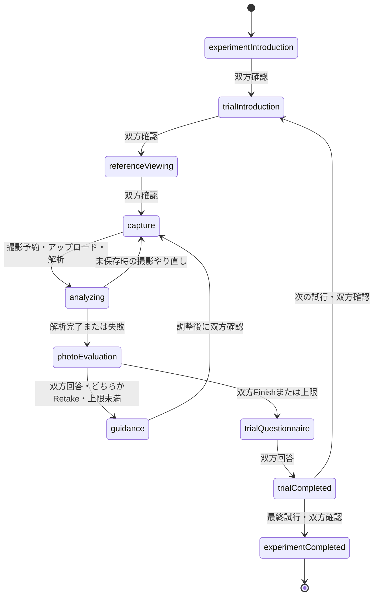

# 参加者主導の撮影実験フロー

更新日: 2026-10-05。`flowProtocolVersion=participant-flow-v1`、`guidanceProtocolVersion=progressive-v1`。

事前に実験計画と参照写真を用意すれば、参加者2人が画面に従って練習から全試行終了まで進める構造を実装した。研究者による各trialの条件設定・開始・終了操作は不要。練習＋本番6試行の完走はHTTP/WS結合テストで確認した。ただし、実端末2台のカメラ・操作・通信を含む無介助完遂は未確認であり、本実験投入前のパイロットが必要。

データ保全・CSV・品質検査・中断・ペア切替の追加仕様は [研究運用ガイド](research-operations.md) を参照。

## 1. 参加者の操作

1. 被写体がiOSホームの「ユーザ実験を開始・再開」を開き、案内されたペア番号で開始する。
2. 「撮影する方をQRで招待」を押し、撮影者がWebへ参加する。双方が説明を確認する。
3. 練習の説明・参照写真をそれぞれ確認する。撮影者がカメラ権限を許可して撮影する。被写体にはライブ映像と固定ガイドを表示する。
4. 撮影した写真を双方が確認し、似ている度合い・満足度・撮り直し希望を独立して回答する。先に回答した側は待機する。
5. 撮り直す場合、各自の指示を読み、調整して「調整できたら次の撮影へ」を押す。双方の確認後、撮影へ戻る。
6. 両者が終了を希望するか上限に達したら、各自が試行アンケートへ回答する。双方が終わると最終写真を確認し、次の試行へ進む。
7. 「撮影 1 / 6」から計画順に繰り返し、最後は「実験はすべて終了です」。iOSで最終写真の確認・保存ができる。同じ端末を次のペアに渡す場合は「別のペアの実験を開始」を押す。

練習は`isPractice=true`。練習も同じ終了判定なので、最初から双方Finishなら再撮影を体験しない。練習で撮り直しを体験させる場合は導入説明で一度選ぶよう案内する。練習での再撮影強制はしていない。

## 2. 状態機械



正となる状態はサーバーの`experiment/flow.json`。`practice`は別phaseにせずtrialの属性、`adjustment`はguidance画面での作業として扱う。`waitingForPartnerEvaluation`は全体phaseではなく、回答済みの役割だけに返す`viewPhase`である。回答・確認・現在trial・撮影系列・revision・次の行動をサーバーから復元する。

## 3. A/B/Cの体験差

| 内容 | A | B | C |
|---|---|---|---|
| 参照写真・固定骨格ガイド・ライブ映像・撮影・評価 | 共通 | 共通 | 共通 |
| 撮り直し時 | 一般的な再撮影案内のみ | 自分の役割の全未解決候補 | 自分の役割の最優先1件 |
| 自動Ready | 非表示 | 既定非表示。showReadyToParticipants=true時のみ使用 | 同左 |

解析は撮影後に全条件で行い、**評価中には指示・Readyを表示しない**。双方の回答が揃い、撮り直しと決まった後だけ表示する。管理対象セッションでは従来の`roleGuidanceUpdated`・解析通知を配信せず、認証付き状態取得から該当役割の指示のみを渡す。参加者画面には条件名・内部IDを表示しない。候補順位付け・閾値・改善判定は既存Progressive Guidanceを利用する。

## 4. 写真評価

両端末に最新写真、折りたたみの参照写真、未選択から始まる必須3項目を表示する。

- 類似度: 1＝全く近くない、7＝とても近い。
- 満足度: 1＝全く満足していない、7＝とても満足している。
- 撮り直し: 「撮り直したい」「この写真でよい」。

相手の評価値と撮り直し回答はAPI・WebSocketに含めない。自分の送信済みフラグのみを返す。同じ回答の再送は成功として扱い、回答の変更は409で拒否する。入力途中はWebのlocalStorage / iOSのUserDefaultsへ保存する。

## 5–7. 撮り直し、上限、試行終了

| 撮影者 | 被写体 | 上限未満の動作 |
|---|---|---|
| Finish | Finish | 終了 |
| Retake | Finish | 撮り直し |
| Finish | Retake | 撮り直し |
| Retake | Retake | 撮り直し |

`maximumCaptureCount`は既定5、1〜50。trial設定→plan設定→フロー設定の順に優先する。最後の撮影前に「最後の撮影です」を表示する。上限到達時も双方が評価してから終了し、終了理由は`maximum_capture_count`を優先する。それ以外の双方Finishは`mutual_finish`。

アップロード成功写真だけを撮影回数に数える。未保存のやり直しは回数に含めず、captureSequenceは欠番を許してセッション内単調増加とする。`finalPhotoId`・`finalCaptureSequence`・`completionReason`・`captureEndTime`をtrialに保存し、最終写真を受信写真一覧へコピーする。アンケート完了時が`trialCompleted`であり、撮影終了時と区別する。

## 8. アンケート

`backend/experiment_flow_config.json`で質問文・ID・表示条件を設定し、開始時に設定を固定する。各trial（練習含む）で双方が回答する。

- 共通4問: 難易度、直す箇所の分かりやすさ、協力しやすさ、精神的負担。
- B/Cのみ4問: 指示の有用性、指示量、邪魔に感じたか、提示方法の明確さ。
- 最終写真の満足度・参照写真への類似度は、最終Captureの回答を使用（重複質問なし）。
- 任意自由記述: 困ったこと・気になったこと、2000文字以内。

すべて1〜7（全くそう思わない〜とてもそう思う）。新規セッションはAが4問、B/Cが8問（role-aware-trial-v2）。旧セッションは開始時の質問を維持します。条件ブロック単位や実験終了後の総括比較アンケート、NASA-TLX等は未実装。

## 9. 条件・参照写真の割当と研究者の事前準備

1. 既存の研究者向け「実験」画面で参照画像を登録し、関節点を確認・補正・保存する。画像ごとのsourceSessionIdとreferenceImageIdを控える。開始時にはその参照の`current.json`を採用する。
2. `backend/experiment_plans/example.example.json`を別名（例`P01.json`）へコピーし、実在するペア番号、planId、参照ID、sourceSessionIdへ置き換える。`*.example.json`は開始一覧に出ない。
3. `practice`1件と`trials`配列を指定する。配列順が実施順。本番にはA/B/Cをすべて含める。例はA2・B2・C2の計6件だが件数は変更可能。各ペアで条件順と6枚の割当を編集する。Latin Squareの自動生成は未実装。
4. `GET /api/participant-experiments/plans`で`available=true`を確認する。画像、参照姿勢、人数承認、ID、上限等を事前検証する。複数のplanで同じplanIdを使わない。
5. iOSとWebの接続先、HTTPS/WSS、モデルを準備し、実機で1セッションを予行する。

計画ディレクトリは`EXPERIMENT_PLAN_DIR`、質問・既定上限は`EXPERIMENT_FLOW_CONFIG`で変更できる。開始時に計画、質問、すべての試行と参照画像のコピー、ReferenceGuide、骨格PNG、解析設定を固定する。開始後の元参照修正やplan編集は進行中セッションに適用しない。

リポジトリには実写真を割り当てた有効な計画を同梱していない。実験用刺激の選定・補正・ペア別割当が必要。参加者実験はTTL削除対象外として同じ保存先に保持する（方法A）。準備元の通常セッションは既定6時間なので保存期間を調整する。研究データはバックアップCLIで保管する。

## 10. 保存形式

```text
uploads/<sessionId>/
├── references/                         # 開始時にコピーした参照画像
├── guides/                             # 固定PNG・features
├── drafts/                             # 撮影写真
├── photos/                             # 各trialの最終写真
├── analysis/history/<analysisId>.json  # 既存の客観解析・候補・改善
└── experiment/
    ├── session.json
    ├── experiment-plan.json
    ├── flow.json                       # 正の状態・役割トークン・質問設定
    └── trials/<trialId>/
        ├── trial.json
        ├── guidance-config.json
        ├── events.jsonl
        ├── evaluations/capture_<sequence>.json
        └── questionnaire.json
```

撮影評価は`captureSequence/photoId/analysisId`、両役割の`similarityRating/satisfactionRating/wantsRetake/submittedAt`、`decision.nextAction/completionReason`、`agreement`、解析状態・失敗理由、表示時刻を保持する。アンケートは`responses.photographer/subject`へ独立保存する。

## 11. イベント

追加: `experiment_started`、`trial_started`、`reference_viewed`、`capture_started`、`photo_captured`、`photo_evaluation_started`、`photographer_evaluation_submitted`、`subject_evaluation_submitted`、`evaluations_completed`、`retake_decided`、`trial_finish_decided`、`guidance_displayed`、`guidance_acknowledged`、`recapture_started`、`trial_questionnaire_started`、`trial_questionnaire_submitted`、`trial_completed`、`experiment_completed`、`capture_upload_abandoned`。

既存の`events.jsonl`追記・eventId重複排除を利用する。フローイベントのpayloadにsessionId、participantPairId、trialId、conditionId、guidanceProtocolVersion、captureSequence、photoId、analysisId、サーバー時刻を付与する。撮影前等、未発行のIDはnull。回答値の正本は評価ファイルであり、通知やイベントへ重複保存しない。

## 12. 客観・主観データの結合

trial→finalCaptureSequenceで最終評価を特定し、analysisIdで`analysis/history`へ結合する。客観誤差・totalError・Ready・候補・guidanceProgressと、双方の類似度・満足度・再撮影希望を同じ撮影で追える。

`similarityGap`と`satisfactionGap`は評価差の絶対値。試行撮影時間は`startTime→captureEndTime`、アンケート込みは`startTime→endTime`。撮影枚数はphotoIdを持つ評価記録、Retake回数はdecision、指示表示はguidance_displayed（role別）で数える。Aの一般案内も表示イベントを持つため、自動指示数はselectedGuidanceが空でないものを数える。

次撮影の評価記録へ`previousCaptureSequence`と`guidanceToCaptureMs`（役割別、サーバーの表示受信→撮影予約時刻）を保存する。端末表示時刻も保存するが時計差は未補正であり、実際の表示からシャッターまでの精密時間とは区別する。CSV出力と品質サマリーは実装済み。高度な統計・ダッシュボードは未実装。

## 13. API・同期・復旧

`/api/participant-experiments`配下に`GET plans`、`POST start`、`GET :sessionId/state`、`POST :sessionId/{ack,capture,evaluation,questionnaire,displayed,retryUpload}`を追加した。状態操作には`X-Experiment-Token`、回答にはtrialIdとcaptureSequenceを送る。撮影予約後に既存draft-photosへトークンと`X-Flow-Capture-Sequence`を付けてアップロードする。解析はサーバーが既存処理を呼ぶ。

WebSocketは回答を含まない`experiment-flow-updated`のrevision通知だけを追加する。両クライアントは状態を再取得し、2秒ポーリングも併用する。古いrevision・別trial・別撮影への操作は採用しない。WebはURL/sessionStorage、iOSはUserDefaultsに参加情報を保持する。開始リクエストのstartKeyを端末へ先に保存し、開始応答が失われても同じセッションに復帰する。

解析待ちでサーバーが再起動した場合、状態取得から未完了解析を再投入する。解析失敗でも評価へ進み、再撮影を選べる。未アップロード時は撮影者がやり直せる。カメラ権限・接続不調は撮影画面から再接続できる。評価は同内容を再送可能、異なる内容への変更は拒否する。通常セッションの期限切れ削除や端末情報の手作業消去からの自動復旧は対象外。参加者実験はTTL対象外であり、終了後のペア切替は両端末の参加情報を明示的に消去する。ファイル単位のatomic renameを使用するが、複数ファイル更新途中の強制終了に対するトランザクション保証はない。

回答とトークンのある`experiment/`、内部解析の`analysis/`は管理対象セッションで静的配信を禁止し、旧イベント取得・旧書込みAPIも拒否する。役割トークンはアカウント認証ではなく参加用の共有秘密である。写真・映像等の既存配信全体の認証化は未実装。

## 14. 追加・変更ファイル

| ファイル | 内容 |
|---|---|
| `backend/experiment_flow.js` | 状態管理・役割別応答・回答・判定・復旧・API |
| `backend/experiment_flow_config.json`、`experiment_plans/example.example.json` | 質問・上限・ペア別計画 |
| `backend/server.js` | 固定参照の再利用、撮影予約との連結、解析通知制御、最終写真共有、内部記録の配信制限 |
| `photographer/participant-flow.js` | 撮影者の進行・評価・アンケート画面 |
| `photographer/script.js`、`index.html`、`style.css` | 既存カメラとの連結、参加者画面のスクロール・エラー表示 |
| `photo2026/photo2026/ParticipantExperimentView.swift`、`HomeView.swift` | 被写体の開始・進行・回答・ライブ映像・再開 |
| `backend/test/participant-*.test.js` | 状態・Web表示・HTTP/WS連携テスト |
| `photo2026/photo2026Tests/photo2026Tests.swift` | 参加者状態のデコードテスト |
| `backend/package.json`、`.env.example` | テストコマンドと設定 |
| `README.md`、`REQUIREMENTS.md`、`EXPERIMENT_REQUIREMENTS.md`、`RUNNING.md`、両設計文書、親`TODO.md` | 実装済みと残課題の更新 |

## 15. 検証結果

- `npm run test:session-flow`: 既存の映像中継・ガイド更新・終了通知・再接続に合格。
- `npm run test:guidance`: 参照補正・固定・A/B/C・改善・再悪化・旧表示ロジック・HTTP/WS連携に合格。
- `npm run test:participant-flow`: 状態遷移、双方Finish、片方Retake、上限、独立回答、重複、未保存やり直し、A非表示/B複数/C1件、回答待ち中のサーバー再起動、古い結果、アンケート、練習＋本番6試行の完走に合格。Webの初期通信失敗・送信後ボタン・古いrevisionも検証。
- Python既存15＋Progressive9＝24件に合格。
- iOS Simulatorでビルド・Swift単体6件・既存UIテスト6実行に合格。UIテストは起動確認・起動性能であり、参加者の全操作を自動化したものではない。

HTTP/WSテストでは画像モデル推論のみfixtureに置換し、Pythonのガイド描画と採点は実行する。実写真の認識精度やカメラ撮影自体を保証するテストではない。

## 16–17. 実機確認と本実験前に必要なもの

- 実参照写真（練習＋本番）、補正姿勢、ペア別計画を準備する。参照の難易度、順序と割当の妥当性を確認する。
- 実機2台で、QR→権限→ライブ映像→全評価→再撮影→アンケート→最終保存を無介助で完遂する。質問の見切れ、スクロール、左右指示、ガイド整合も確認する。
- 撮影・回答中のリロード、アプリ再表示、回線断、アップロード失敗、権限拒否を試す。iOSのバックグラウンド復帰も確認する。
- 実モデルの失敗率・遅延・閾値を校正する。Python同期起動中はNodeイベントループを占有するため、解析中の通信遅延も測定する。
- 保存期間とバックアップ、研究参加同意・中断手順を決める。途中辞退・研究者向けデータExport・バックアップは実装済み。再開可能な一時停止UIは未実装。

完成判定: **ソフトウェア上の無介助進行は実装・結合試験済み。実参加者2人の画面案内だけでの完遂は、実機パイロット合格後に判断する。**
